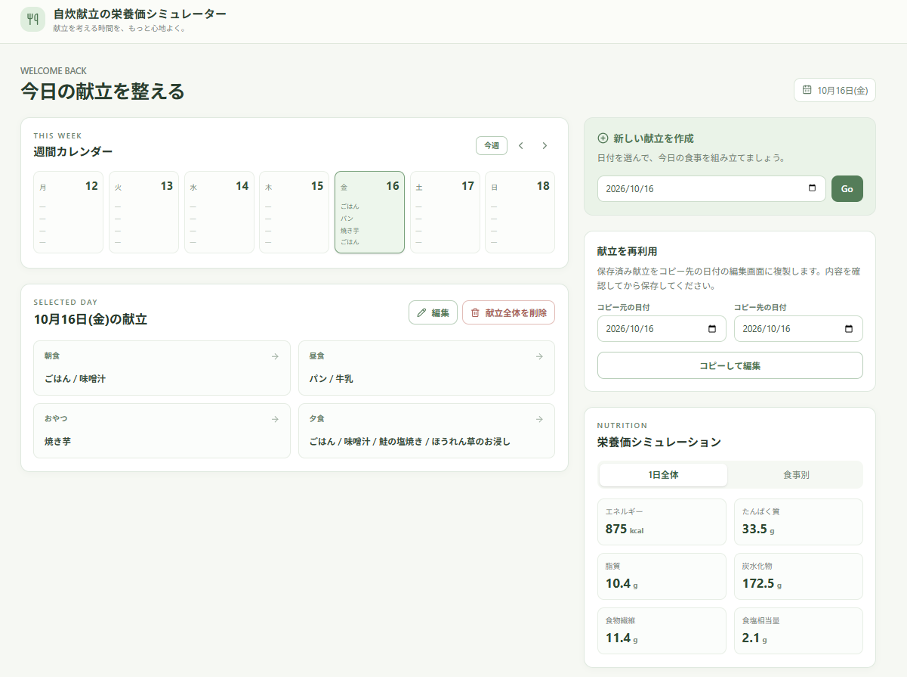

# 自炊献立の栄養価シミュレーター

meal-nutrition-simulator

## アプリ概要

Next.jsとSupabaseを用いた、自炊献立の栄養価をシミュレーションできるアプリです。

日付ごとに朝食・昼食・おやつ・夕食の料理名と、使用食材・使用量（g）を入力すると、以下の6種類の栄養価を自動計算します。
- エネルギー
- たんぱく質
- 脂質
- 炭水化物
- 食物繊維
- 食塩相当量

食事別・1日全体の栄養価を確認できるほか、作成した献立の保存・編集・削除や、過去の献立の再利用にも対応しています。

## 目的

毎日の献立を考える際に、使用する食品とその量によって栄養価がどのように変化するかを、簡単に確認できることを目指しました。

## サイトイメージ

## サイトURL

[自炊献立の栄養価シミュレーター](https://meal-nutrition-simulator.vercel.app/)

## 使用技術

| 分類 | 使用技術・ツール |
|---|---|
| フロントエンド | Next.js、React、TypeScript |
| バックエンド | Next.js（API Route）、Supabase RPC |
| データベース | Supabase（PostgreSQL） |
| 認証 | Supabase Authentication（匿名認証） |
| セキュリティ | Row Level Security（RLS） |
| デプロイ | Vercel |
| 開発環境 | Visual Studio Code |
| UIプロトタイプ作成 | v0 |
| バージョン管理 | Git、GitHub |
| テスト・デバッグ | DevTools（Chrome） |
| CI/CD | GitHub Actions（Next.js自動ビルドチェック） |

## 設計ドキュメント

[要件定義・基本設計・詳細設計の一覧_Googleスプレッドシート](https://docs.google.com/spreadsheets/d/14pmUDNuV1ZwNHqdY2zl5iTgMHvAmk6M5CL-i2Wni_Ho/edit?usp=sharing)

詳細設計で作成した以下の資料は、docsディレクトリに格納しています。
- ワイヤーフレーム図
- ワークフロー図
- ER図

[設計資料はこちら](docs)

## 機能一覧
### 1.食材一覧取得

- Supabaseに登録された食品データ取得
- 登録済み食品36品目から選択
- 各食品の100g当たりの栄養価を計算に使用

### 2.献立作成・管理（CRUD）

- 日付ごとに献立を新規作成
- 作成した献立をSupabaseに保存
- 保存済み献立を読み込み・表示
- 料理名・食品・使用量の編集
- 料理・食品の削除
- 献立全体の削除
- ページを再読み込みしても保存内容を保持

### 3.食事・料理の登録

- 朝食・昼食・おやつ・夕食の4区分に対応
- 食事区分ごとに複数の料理を登録
- 料理ごとに複数の食品と使用量（g）を登録
- 食品の使用量を変更すると栄養価を自動で再計算

### 4.栄養価計算（本アプリのメイン機能）

各食品について、次の式で栄養価を計算します。

***栄養価 ＝ 100g当たりの栄養価 × 使用量（g）÷ 100***

- エネルギー・たんぱく質・脂質・炭水化物・食物繊維・食塩相当量を計算
- 複数食品・複数料理の栄養価を合算
- 食事別・1日全体の表示切り替え
- 食品の使用量変更に応じた自動再計算

### 5.週間カレンダー・献立表示

- 週間カレンダーで日付ごとの献立を確認
- 日付を選択して献立の詳細を表示
- 前週・翌週への移動
- 保存済みの料理名をカレンダーに表示
- 日付ごとに献立を管理

### 6.献立再利用
- 保存済みの献立を別の日付へコピー
- 料理名・食事区分・食品・使用量を複製
- コピー先で編集してから保存
- コピー元の献立は変更せず保持
- コピー先に既存の献立がある場合は上書きを確認

### 7.認証・データ管理

- Supabaseの匿名認証を使用
- ログイン操作なしで献立を作成・保存
- 匿名セッションを再利用
- RLSにより、ユーザーごとの献立データを分離
- Supabase RPCによる献立データの一括保存・削除

### 8.エラー処理・入力チェック

- 未入力や不正な使用量の保存を防止
- データ取得・保存・削除の失敗時にエラーを表示
- 保存・削除に失敗した場合は既存の入力内容や献立を保持
- 通信復旧後の再試行に対応

## テスト・修正の設計及び実施書

単体テストおよび結合・総合テストを実施し、各機能の動作確認と修正を行いました。

[テスト・修正の設計及び実施書_Googleスプレッドシート](https://docs.google.com/spreadsheets/d/1IwKAIKxjNKAZCmbjPp_emGhW-7g4fW71-MAQ21uIvJ0/edit?gid=112983914#gid=112983914)

## アプリの改善案

ユーザーの利便性向上と、開発・運用の品質向上を目的として、機能改善・リファクタリング・CI/CDの観点から改善案を整理しました。

 [アプリの改善案_Googleスプレッドシート](https://docs.google.com/spreadsheets/d/1OF6X1NRiH0_OoaQtsoZJR5IhYF2F_tfoE-DZGANQrtE/edit?gid=482600378#gid=482600378)

## 備考

### GitHub Actionsの実行結果

GitHub Actionsを使用し、Next.jsアプリの自動ビルドチェックを実施しました。

[GitHub Actions実行結果](https://github.com/11bear-UW25/meal-nutrition-simulator/actions/workflows/ci.yml)

### 開発時に活用した生成AI

- ChatGPT：要件定義・設計の相談、技術調査、エラー対応、テスト項目の整理
- GitHub Copilot：コードの実装・修正、エラー調査、型チェック・ビルド確認
- Claude：設計の相談
- v0：画面UIのプロトタイプ作成

生成AIを開発の補助として活用しながら、実際の動作確認やテスト、修正内容の確認を行いました。
